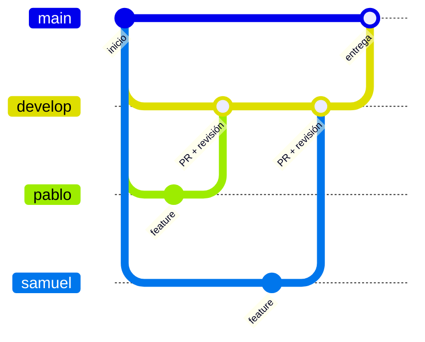

<div align="center">

# ⚽ Head Soccer

### Proyecto universitario · Escuela Colombiana de Ingeniería Julio Garavito

*Un videojuego de fútbol 1 vs 1 con cabezones, desarrollado en Java.*

[](https://github.com/PaglkG/ProyectoFinal-Dopo/actions/workflows/build.yml)


</div>

---

## 📖 Sobre el proyecto

Este repositorio contiene el **proyecto final** de la asignatura, desarrollado en la **Escuela Colombiana de Ingeniería Julio Garavito** como parte del programa de **Ingeniería de Sistemas**. Es un trabajo **académico y sin fines comerciales**: el objetivo es aplicar análisis de requisitos, diseño orientado a objetos, pruebas automáticas y trabajo colaborativo con Git.

El juego que implementamos es una versión propia inspirada en **Head Soccer**, el juego ganador de la convocatoria *Juego 2026-2*.

> ⚠️ **Aviso:** *Head Soccer* es un juego creado por **D&D Dream Corp.** Este proyecto es una reinterpretación educativa; no está afiliado ni respaldado por sus creadores, y no se distribuye con fines comerciales.

## 🎮 ¿De qué trata Head Soccer?

*Head Soccer* es un juego de fútbol arcade, **uno contra uno**, donde los jugadores son personajes de **cabeza enorme** que golpean el balón con la cabeza y los pies. Lo lanzó D&D Dream Corp. en 2012 para móviles, y sus propios desarrolladores reportan más de 100 millones de descargas.

La idea es simple y se aprende en segundos:

- 🥅 **Gana quien marque más goles** antes de que se acabe el tiempo del partido.
- 🏃 Te mueves de lado a lado, **saltas** para cabecear y **pateas** para disparar.
- 💥 Puedes ejecutar **tiros especiales** (por ejemplo, de fuego, hielo o rayo).
- 🧠 Si vas arriba en el marcador, defender bien hasta el final también es una estrategia.
- ⚙️ Usa **física** para el balón y los rebotes, lo que hace cada partido impredecible.

### Elementos característicos del juego original

| Elemento | Descripción |
|---|---|
| 🧑‍🎤 **Personajes** | Decenas de avatares, cada uno con su propio tiro especial. |
| 🏆 **Modos de juego** | Arcade, Torneo, Supervivencia, Liga, Copa y otros modos más extremos. |
| 🌍 **Multijugador** | Partidas contra amigos o jugadores en línea. |
| 🐾 **Personalización** | Sistema de mascotas y de cuerpos/accesorios para el personaje. |
| 🎯 **Controles** | Mínimos: moverse, saltar y patear. |

> Las versiones web del juego se controlan con las **flechas del teclado** para moverse y la **barra espaciadora** para saltar.

## 🕹️ Características de nuestra versión

> 🚧 *Esta sección se irá completando a medida que se definan los requisitos del proyecto.*

- [ ] Partida 1 vs 1 con temporizador y marcador
- [ ] Movimiento, salto y golpe del balón
- [ ] Física del balón y colisiones
- [ ] Selección de personajes
- [ ] Tiros especiales
- [ ] Modo contra la máquina
- [ ] Modo dos jugadores en el mismo equipo
- [ ] Pruebas unitarias con JUnit 5

## 🧰 Tecnologías

| Herramienta | Uso |
|---|---|
| ☕ **Java** | Lenguaje principal |
| 📦 **Maven** | Gestión de dependencias y compilación |
| 🧪 **JUnit 5** | Pruebas unitarias |
| 🤖 **GitHub Actions** | Integración continua (`build-and-test`) |
| 🔀 **Git / GitHub** | Control de versiones y revisión de código |

## 🚀 Cómo ejecutarlo

**Requisitos:** JDK 21 (o la versión definida en el `pom.xml`) y Maven 3.9+.

```bash
# 1. Clonar el repositorio
git clone https://github.com/PaglkG/ProyectoFinal-Dopo.git
cd ProyectoFinal-Dopo

# 2. Compilar y ejecutar las pruebas
mvn clean verify
```

> La instrucción para lanzar el juego se añadirá cuando exista la clase principal.

## 🌿 Flujo de trabajo

Trabajamos con ramas protegidas y revisión cruzada entre integrantes.



| Rama | Propósito | Reglas |
|---|---|---|
| `main` | Versiones estables, listas para entregar | Pull Request, 1 aprobación, CI obligatoria |
| `develop` | Integración del trabajo del equipo | Pull Request, 1 aprobación, CI obligatoria |
| `pablo` / `samuel` | Ramas personales de desarrollo | Sin borrado ni *force push* |

Los cambios se integran con **merge commit**, y cada Pull Request lo revisa la otra persona del equipo.

## 👥 Equipo

| Integrante | GitHub |
|---|---|
| Pablo | [@PaglkG](https://github.com/PaglkG) |
| Samuel | [@usuario-samuel](https://github.com/) |

## 🎓 Contexto académico

- **Institución:** Escuela Colombiana de Ingeniería Julio Garavito
- **Programa:** Ingeniería de Sistemas
- **Tipo de trabajo:** Proyecto final universitario
- **Juego asignado:** Head Soccer (*Juego 2026-2*)

## 📚 Créditos y referencias

- *Head Soccer* © **D&D Dream Corp.** — juego original que inspira este proyecto.
- Convocatoria *Juego 2026-2*, Escuela Colombiana de Ingeniería.

---

<div align="center">

Hecho con ☕ y mucho código en Bogotá, Colombia 🇨🇴

</div>
